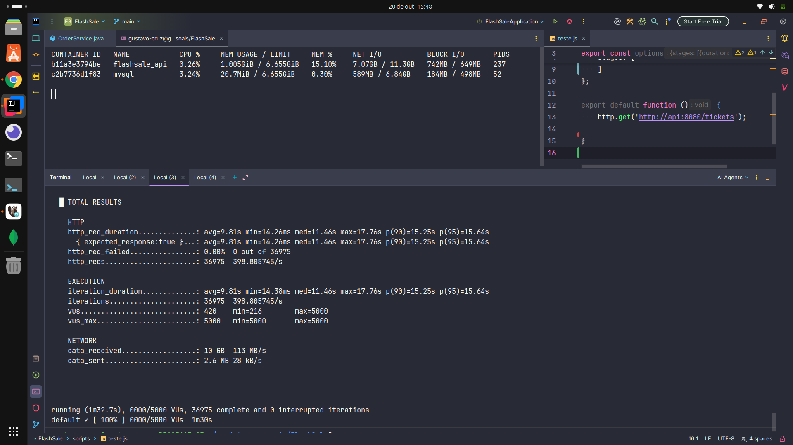
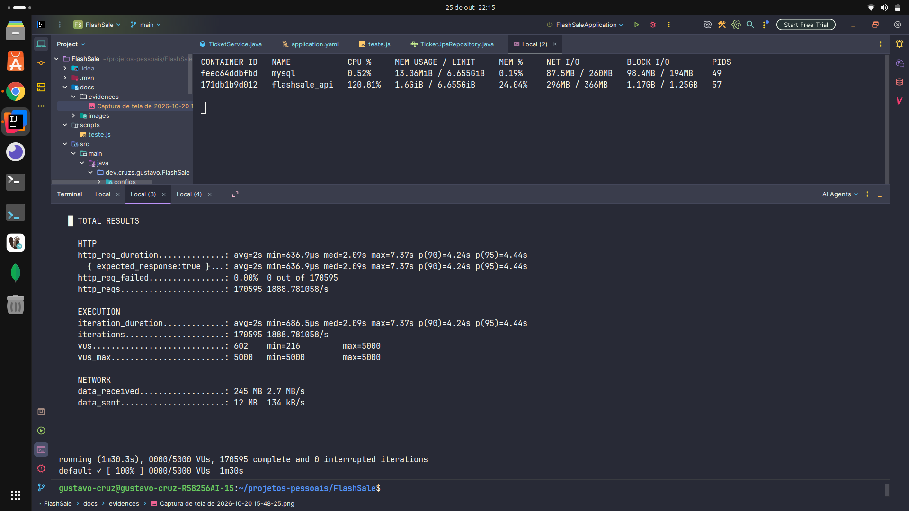

# 🎫 FlashSale API


> Uma API de vendas de ingressos de alta concorrência (*Flash Sale*), projetada inicialmente como um monolito modular.

---

## 🎯 Sobre o Projeto e o Desafio

A **FlashSale API** é um projeto laboratório focado em engenharia de software de alta concorrência. O cenário simulado é uma venda relâmpago de ingressos altamente disputada, como um lote promocional de festival.

O objetivo principal é garantir as seguintes regras de negócio sob pressão extrema:

1. **Zero Overbooking:** impedir a venda de mais ingressos do que o disponível, mesmo com múltiplas tentativas de compra simultâneas.
2. **Reserva Temporária e Liberação Automática:** garantir o ciclo de vida do ingresso (Disponível → Pendente → Vendido/Cancelado).
3. **Consistência Distribuída:** orquestrar o pagamento e a notificação de forma consistente.

Aplicação foi construída intencionalmente como um monolito para estabelecer uma *baseline* de performance. O objetivo é executar testes de carga, identificar gargalos (*race conditions*, latência de banco de dados e falhas de integração) e documentar a evolução arquitetural para resolver esses problemas.

---

## 🏛️ Decisões Arquiteturais e de Negócio

### 1. Monolito Modular

- **Decisão:** a API foi construída inicialmente como um monolito, mas com pacotes isolados por domínio (`ticket`, `order`, `payment` e `notification`).
- **Justificativa:** acelerar o desenvolvimento inicial, reduzindo o *boilerplate* de infraestrutura distribuída, como filas, *service discovery* e comunicação de rede. Isso permite validar as regras de domínio antes de introduzir a complexidade de microsserviços. Quando um gargalo for identificado, a extração de um domínio poderá ser planejada.

### 2. MySQL como Banco de Dados

- **Decisão:** adoção do MySQL.
- **Justificativa:** o modelo de dados (ingressos, pedidos e notificações) é relativamente simples e não exige consultas analíticas complexas. O MySQL atende às necessidades da arquitetura inicial.

### 3. Integração com Serviços Externos via Adapters

- **Decisão:** utilização do padrão Adapter (Gateways) para isolar as integrações.
- **Provedores iniciais:**
    - **Mercado Pago:** pagamentos via PIX e cartão de crédito.
    - **Mailtrap:** serviço de envio de e-mails.
- **Justificativa:** isolar o núcleo da aplicação dos SDKs externos. A substituição do Mercado Pago por Stripe ou do Mailtrap por AWS SES exige alterações principalmente na camada de infraestrutura, mantendo o domínio desacoplado dos provedores.

### 4. Fluxo de Compra e Identidade

- **Decisão de negócio:** a compra não exige a criação prévia de login ou conta na plataforma.
- **Fluxo:** a transação é vinculada ao CPF informado. Após a confirmação, a entrada no evento é validada pelo CPF associado ao pedido.
- **Justificativa:** simplificar o funil de conversão e reduzir etapas no processo de compra, especialmente em cenários de *compras rápidas*.

### 5. Controle Transacional Programático (`TransactionTemplate`)

- **Decisão:** substituição do `@Transactional` declarativo pelo uso do `TransactionTemplate` na camada de `OrderService` para demarcar limites transacionais de forma cirúrgica.
- **Justificativa:** em cenários de alta concorrência, manter uma transação de banco de dados aberta enquanto o sistema aguarda o retorno de APIs externas (Mercado Pago ou Mailtrap) leva rapidamente ao esgotamento do *Connection Pool*. Isolando apenas as operações de banco (`orderJpaRepository` e `ticketService`) dentro do `TransactionTemplate`, a conexão é liberada em milissegundos, realizando o I/O de rede com o banco livre.
- **Justificativa — trade-offs conscientes:**
  - Ao tirar o serviço de e-mail de dentro da transação, assume-se o risco de o banco commitar a confirmação da venda e o e-mail falhar na sequência.
  - O modelo mental adotado prioriza a **ação do cliente e o negócio**: garantir o processamento do pagamento e a reserva do ingresso no banco é mais crítico do que garantir a entrega da notificação. Tratativas de retentativa de e-mails falhos poderão ser implementadas em evoluções futuras da arquitetura.

---

## 🛠️ Tecnologias Utilizadas

- **Java 21**
- **Spring Boot 3:** WebMVC, Spring Data JPA e Validation
- **MySQL:** banco de dados relacional
- **Docker e Docker Compose:** containerização
- **Lombok**
- **JUnit 5:** testes automatizados
- **Swagger / SpringDoc OpenAPI 3:** documentação da API
- **Mercado Pago Java SDK:** integração de pagamentos
- **Mailtrap Java SDK:** integração de e-mails

---

## 🚀 Como Executar o Projeto Localmente

### Pré-requisitos

- Docker e Docker Compose instalados.
- Conta no Mercado Pago para obter credenciais de teste.
- Conta no Mailtrap para obter as credenciais de e-mail.

### 1. Clone o repositório

```bash
git clone https://github.com/GUSTAV0-CRUZ/flashsale.git
cd flashsale
```

### 2. Configure as variáveis de ambiente

Crie um arquivo `.env` na raiz do projeto com suas credenciais:

```dotenv
MERCADO_PAGO_ACCESS_TOKEN=seu_access_token_aqui
MERCADO_PAGO_SECRET_SIGNATURE=sua_secret_signature_aqui
MAILTRAP_TOKEN=seu_mailtrap_token_aqui
```

Certifique-se de que o `docker-compose.yml` e a configuração do Spring Boot utilizem essas variáveis com os nomes correspondentes.

### 3. Suba os containers

```bash
docker-compose up -d --build
```

O serviço MySQL possui um *healthcheck* configurado. A API Spring Boot (`flashsale_api`) deverá iniciar após o banco de dados estar saudável, conforme a configuração do Docker Compose.

### 4. Acesse a documentação da API

Swagger UI ou documentação OpenAPI:

```text
http://localhost/swagger-ui/index.html
```

Especificação OpenAPI, caso esteja exposta nesse caminho:

```text
http://localhost/openapi.yaml
```

> Os caminhos dependem da configuração do SpringDoc e do servidor. A porta `80` pressupõe que esteja publicada dessa forma no Docker Compose.

---

## 📚 Endpoints Principais da API

A documentação detalhada dos contratos está disponível no Swagger.

| Método | Endpoint | Descrição |
|---|---|---|
| `GET` | `/tickets` | Lista todos os ingressos. |
| `GET` | `/tickets/{id}` | Busca os detalhes de um ingresso. |
| `POST` | `/tickets/{id}/buy` | Inicia a compra, gerando QR Code PIX ou processando o cartão. |
| `PATCH` | `/tickets/{orderId}/refund` | Solicita o reembolso, considerando as regras de prazo configuradas. |

---

## 📈 Evolução Arquitetural e Métricas de Carga

Esta seção documentará os resultados dos testes de estresse, os gargalos identificados e as refatorações realizadas para melhorar a consistência e o desempenho.

### Decisões Arquiteturais (Otimização de Leitura)

- **Filtro e Limitação:** Restrição da busca para exibir apenas 5 ingressos disponíveis de forma aleatoria por vez, reduzindo o payload na rede e mitigando o risco de colisão (vários usuários tentando comprar o mesmo ingresso).
- **Responsabilidade (Aleatoriedade na Aplicação):** Pega os IDs com status `AVAILABLE` e armazena em cache, aleatorizando com o Java para buscar apenas 5 registros aleatórios, aliviando operações do banco.
- **Cache Local (Caffeine):** Armazenamento em memória da lista de UUIDs de ingressos disponíveis, com invalidação automática (`@CacheEvict`) acionada a cada evento de escrita de um ticket.
- **Virtual Threads (Java 21):** Ativação no Spring Boot para gerenciar o alto enfileiramento de usuários sem esgotar o pool de conexões do servidor web.

### Comparativo de Carga (Teste de 5.000 VUs)

**Cenário Inicial (1.000 registros diretos do banco sem otimização):**
- **Rendimento (RPS):** ~398 requisições por segundo.
- **Latência p(95):** 15.64 segundos.
- **Impacto:** 10 GB de transferência de rede e saturação severa de CPU na serialização.

<details>
  <summary>Ver print do teste inicial</summary>


</details>

**Cenário Atual (Busca 5 registros com os ids em memória no Caffeine Cache):**
- **Rendimento (RPS):** 1.888 requisições por segundo (aumento superior a 350%).
- **Latência p(95):** 4.44 segundos (redução de 71% no tempo de espera).
- **Impacto:** Banco de dados totalmente poupado (CPU em ~0.52%) e estabilidade absoluta com 0.00% de erros.

<details>
  <summary>Ver print do teste final</summary>


</details>

👨‍💻 Autor

## 👨‍💻 Autor


**Gustavo Cruz**  
📧 gustavo.cruzs.dev@gmail.com

🔗 https://github.com/GUSTAV0-CRUZ

🔗 https://www.linkedin.com/in/gustavo-cruz-4a467b377

---